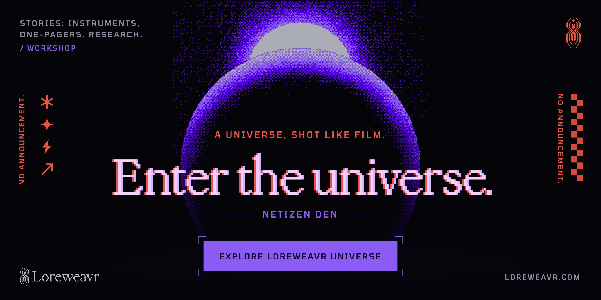
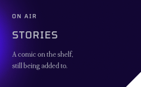
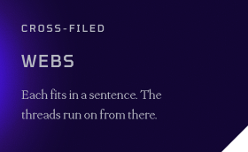
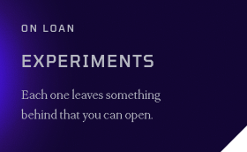
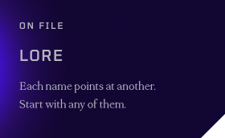

See, don't look

## Inventory

An inventory of the workshop. Every item opens.\
What they add up to is kept off the list.

## Shelves

<a href="https://loreweavr.com"><picture>
  <source media="(min-width: 952px)" srcset="assets/rule-universe-wide.svg">
  
</picture></a>

## Bench

<picture>
  <source media="(min-width: 952px)" srcset="assets/rule-repos-wide.svg">
  
</picture>

- [**Composition vs style**](https://github.com/Loreweavr/flux2-comp-style-decomposition): notes on splitting a Flux 2 LoRA into halves.

- [**Listening to the Stack**](https://github.com/Loreweavr/Listening-to-the-Stack-A-Methodology-for-LoRA-Dataset-Prep): a methodology for preparing a style LoRA’s dataset.

Check the shelves when you pass again.
